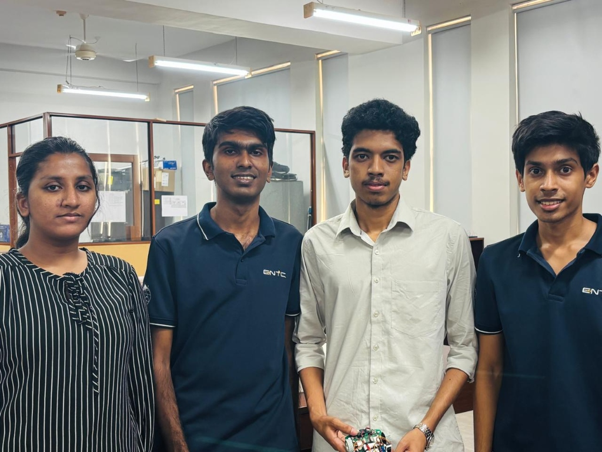

# ⚡ Team Vortex — Analog PID Wall-Following Robot


An autonomous, hardware-driven wall-following mobile robot engineered without microcontroller software abstractions. All spatial tracking, sensor telemetry conditioning, and error compensation are executed using pure operational amplifier networks and analog control loops.

---

## 📌 Project Overview

Traditional autonomous mobile robots rely on high-level digital microcontrollers to execute control loops. **Team Vortex** designed this platform to explore real-time feedback systems at the fundamental circuit level:

* **Pure Analog Feedback Loop:** Zero digital processing latency; direct continuous-time signal flow from sensor input to motor drive output.
* **Active Hardware PID Compute:** Active Op-Amp stages calculating Proportional, Integral, and Derivative gains in real-time.
* **Modular Subsystem Architecture:** Isolated stages for sensor signal conditioning, active filtering, differential error summation, and solid-state power actuation.

---

## 🛠 Tech & Design Stack

| Category | Tools & Hardware |
| :--- | :--- |
| **Circuit Simulation** | LTspice (AC/DC transient analysis & phase margin tuning) |
| **PCB Design** | Altium Designer (Multi-layer layout & differential routing) |
| **Mechanical Design** | SolidWorks (3D chassis design, CAD assembly & center-of-mass modeling) |
| **Control Architecture** | Precision Op-Amps, Active Filters, H-Bridge Motor Drivers |

---

## 📐 Control System Architecture

### 1. Sensor Signal Conditioning
Distance sensor analog outputs are passed through low-noise active low-pass filters (Sallen-Key topology) to eliminate high-frequency acoustic/optical noise before error calculation.

### 2. Analog PID Computation
* **Proportional ($K_p$):** Inverting amplifier configuration with variable gain potentiometer for real-time responsiveness tuning.
* **Integral ($K_i$):** Active Op-Amp integrator with reset-discharge path to eliminate steady-state error without windup saturation.
* **Derivative ($K_d$):** High-pass filtered differentiator stage to predict rate-of-change error, preventing wall overshoot during sharp corners.

### 3. Actuation Driver Stage
Calculated PID control voltages are mapped to a high-efficiency solid-state MOSFET H-bridge driver stage, providing low-latency differential steering to the motors.

---

## 📁 Repository Structure

```text
├── docs/                 # Datasheets, system math, and block diagrams
├── schematics/           # Altium Designer schematics and PCB layout files
├── simulation/           # LTspice circuit simulation models (.asc)
├── cad/                  # SolidWorks chassis files (.SLDPRT, .SLDASM, STEP)
├── bom/                  # Component Bill of Materials & sourcing specs
├── images/               # Team & project images
├── .gitignore            # Hardware/EDA temp file filters
└── README.md             # Project documentation
```

---

## 👥 Team Vortex

<p align="center">
  <br>
  <em>Team Vortex: Samaranayaka D.M.K.I. /  Didulanga M.I. /  Diniru G.A.A. /  Dewmina K.U. (left to right)</em>
</p>

