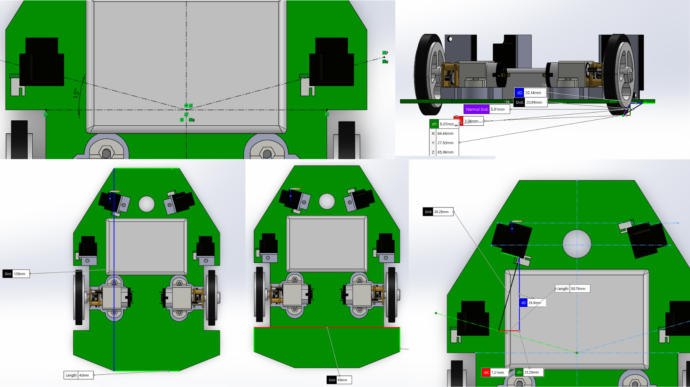

# 🛠️ Mechanical & CAD Assembly

**Integrated PCB Chassis Architecture • Custom 3D Printed Hardware • Multi-Layer Support**

---

This directory contains the complete 3D CAD design files, mechanical assemblies, and structural layouts for the Micromouse robot chassis. The design leverages a **PCB-as-chassis** approach, paired with custom 3D-printed mounting brackets and an elevated backbone for weight optimization, low center of gravity, and modular repairability.

---

## 1. Chassis Overview (Top & Bottom Views)

  

### 🔍 Key Features
* 🟩 **PCB Chassis Integration:** The primary PCB serves double-duty as both the main structural frame and circuit substrate, reducing unnecessary weight and maintaining a tight footprint.
* 🖨️ **3D-Printed Mounts:** Custom brackets house the optical distance sensors and secure the drive motors firmly to the chassis.
* 🔧 **Modular Construction:** Fastener locations are designed for fast disassembly and rapid hardware iteration during testing.

---

## 2. Technical Dimensions & Sensor Alignment

  

### 📐 Physical Specifications & Layout

| Parameter | Specification | Notes / Purpose |
| :--- | :--- | :--- |
| **Width** | `90 mm` | Compact width for narrow maze clearance |
| **Height** | `110 mm` | Total front-to-back chassis footprint |
| **Ground Clearance** | `3 mm` | Optimized center of gravity |
| **Front Sensors (×2)** | `Forward-facing` | Detects front wall proximity |
| **Side Sensors (×2)** | `15° Offset Angle` | Angled relative to side walls for dynamic centering |

---

## 3. Structural Assembly (Before Component Placement)

  

### 🛡️ Mechanical Layering
* 🟦 **Elevated Structural Support:** Positioned **5 mm above the primary PCB**, acting as the main rigid structural spine.
* ⚙️ **Motor Mounting System:** Drive motors mount directly to the structural layer, ensuring strict maintenance of the **3 mm ground clearance**.
* 🔋 **Battery Housing:** The upper deck provides a stable, isolated mounting surface for the power supply.

---

## 4. Chassis Elevation & Side Views

  
  
<i>Side profile view highlighting multi-layer clearance, sensor tilt angles, and wheel alignment.</i>

---

| CAD Environment | Primary Material | Sensor Count |
| :---: | :---: | :---: |
| SolidWorks | FR4 (PCB) + Acrylic + PLA | 4× Distance Sensors |

