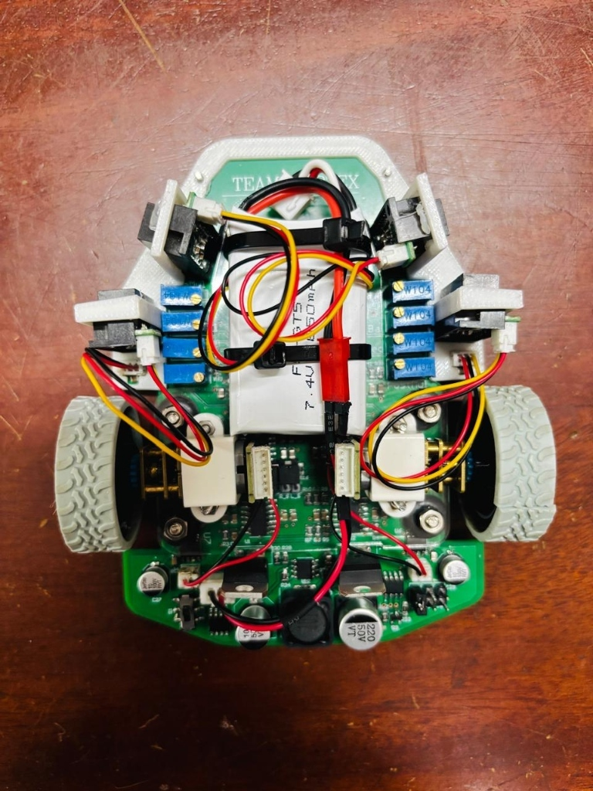
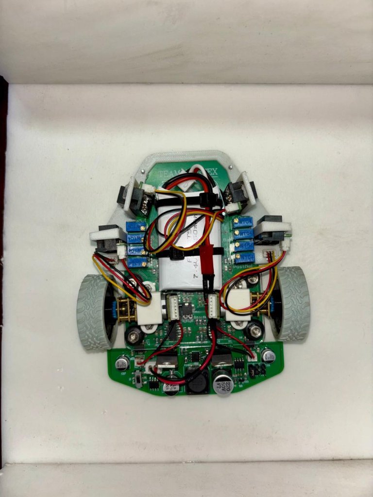

# 🛠️ Mechanical & CAD Assembly Documentation

**Integrated PCB Chassis Architecture • Custom 3D-Printed Hardware • Multi-Layer Support • Sensor Alignment**

---

This directory contains the complete 3D CAD design files, mechanical assemblies, and structural layouts for the Micromouse robot chassis. The design leverages a **PCB-as-chassis** architecture, paired with custom 3D-printed mounting brackets and an elevated structural backbone for weight optimization, a low center of gravity, and modular repairability.

---

## 1. Chassis Overview (Top & Bottom Views)

  

### 🔍 Structural Highlights
- 🟩 **PCB Chassis Integration:** The primary PCB serves double-duty as both the main structural frame and circuit substrate, eliminating excess hardware weight and maintaining a compact footprint.
- 🖨️ **Custom 3D-Printed Mounts:** Precision PLA brackets house the optical distance sensors and anchor the drive motors rigidly to the chassis.
- 🔧 **Modular Construction:** Standardized fastener locations enable rapid disassembly, subsystem access, and quick hardware iteration during maze testing.

---

## 2. Technical Dimensions & Sensor Alignment

  

### 📐 Physical Specifications & Sensor Geometry

| Parameter | Specification | Design Purpose |
| :--- | :--- | :--- |
| **Chassis Width** | `90 mm` | Compact lateral profile for agile maze clearance |
| **Chassis Length** | `110 mm` | Balanced front-to-back wheelbase footprint |
| **Ground Clearance** | `3 mm` | Ultra-low center of gravity for high-speed cornering |
| **Front Sensors (×2)** | `Forward-facing` | Measures front wall proximity and braking distance |
| **Side Sensors (×2)** | `15° Offset Angle` | Angled outward for continuous wall tracking and dynamic centering |

---

## 3. Structural Assembly (Pre-Population Frame)

  

### 🛡️ Multi-Layer Mechanical Architecture
- 🟦 **Elevated Structural Support:** Positioned **5 mm above the primary PCB**, serving as a rigid upper spine that prevents board flex under dynamic loads.
- ⚙️ **Precision Motor Mounting:** Drive motors mount directly to the structural assembly, strictly preserving the **3 mm ground clearance** across the drivetrain.
- 🔋 **Isolated Battery Deck:** The upper structural platform provides a dedicated, mechanically stable mounting surface for the battery pack.

---

## 4. Chassis Elevation & Side Views

  

### 📏 Profile & Clearance Inspection
- 📐 **Multi-Layer Stackup:** Illustrates the vertical separation between the lower FR4 PCB chassis and the elevated 5 mm upper support deck.
- 🎯 **Wheel & Sensor Alignment:** Confirms flush wheel-to-ground contact alongside unobstructed optical paths for both forward and 15°-angled side sensors.

---

## 5. Final Assembled Robot (Physical Prototype)

  
  &nbsp;&nbsp;
   
  <em>Final Assembled Team Vortex Analog PID Robot — Top-Down Hardware Integration (left) &amp; Standard Maze Cell Clearance Verification (right)</em>

### 🤖 Hardware Integration & Real-World Validation
- 🟩 **Complete PCB-to-Chassis Realization:** Confirms accurate mechanical alignment between the SolidWorks CAD model and the fabricated custom **Team Vortex** FR4 PCB chassis, 3D-printed PLA bumper, and mounting hardware.
- 🎯 **4× Sharp IR Sensor Array & PID Tuning Access:** All four optical distance sensors are rigidly seated in custom 3D-printed brackets with clean wire routing, while both banks of multi-turn trimpots (`W104`) remain easily accessible for live analog PID gain tuning.
- 🔋 **Centralized Power & Drivetrain Packaging:** The **7.4 V 650 mAh LiPo** battery pack sits securely along the chassis centerline between the dual N20 gearmotors and 34 mm treaded wheels, maintaining balanced mass distribution and ample turning clearance inside the maze corridor.

---

### 📋 Mechanical & CAD Specifications Summary

| Parameter | Specification | Design Purpose |
| :---: | :---: | :---: |
| **CAD Environment** | SolidWorks | Full 3D parametric modeling & interference checking |
| **Chassis Materials** | FR4 (PCB) + Acrylic + PLA | Lightweight, rigid hybrid structural construction |
| **Overall Dimensions** | 90 mm × 110 mm | Optimized footprint for standard maze cells |
| **Ground Clearance** | 3 mm | Maximizes stability and lowers center of gravity |
| **Sensor Configuration** | 4× Distance Sensors | Dual front + dual 15°-offset side array for continuous wall tracking |

