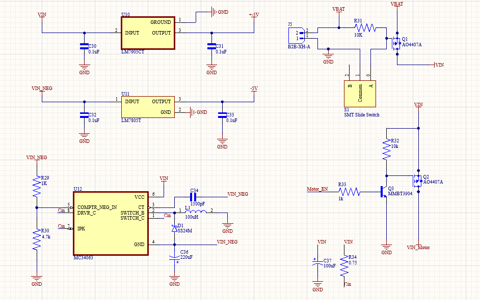
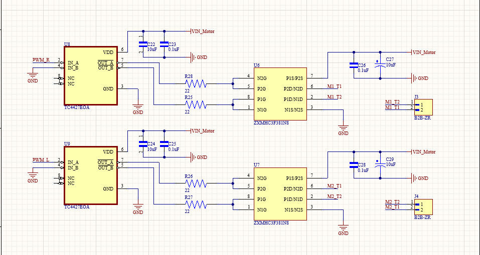
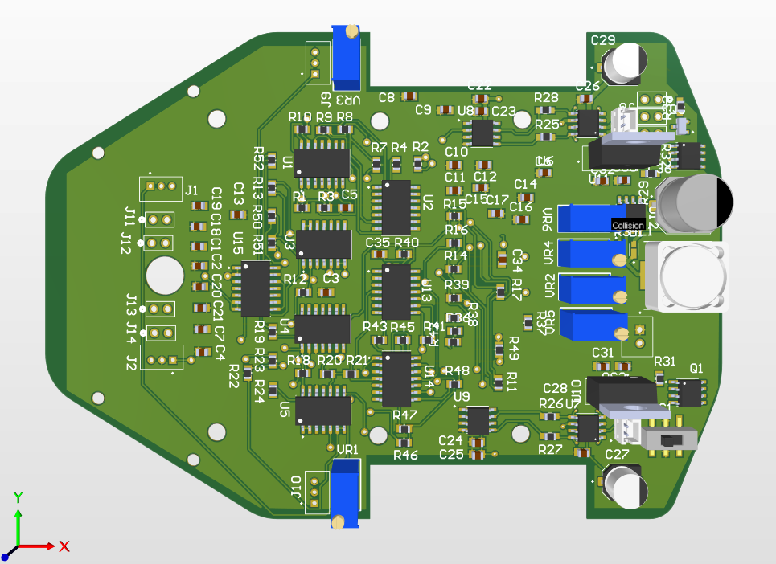

# ⚡ Schematics, PCB Layout & Copper Pour Documentation

**Optimized Component Placement • Multi-Rail Power Planes • Low-Noise Grounding**

---

This directory contains the schematic design files, layout assets, preview images, and structural PCB design files for the controller board. The design focuses on efficient power regulation, high-current motor driving, signal integrity, minimized trace lengths, and noise isolation across multi-layered copper pours.

---

## 1. Power Management Architecture

  

### 🔋 Dual-Rail Power Generation
* 🔄 **Buck Inverter Topology:** Converts and inverts the primary input voltage to create a dedicated negative voltage rail.
* ⚡ **Dual Linear Regulators:** Utilizes dedicated positive and negative voltage regulators to provide stable, low-noise supply rails for analog and logic circuitry.
* 🛡️ **Ripple Suppression:** Decoupling networks ensure continuous, ripple-free power delivery under dynamic load conditions.

---

## 2. Motor Driver & Level Shifting Circuitry

  

### ⚙️ Drive Control Features
* 🔀 **MOSFET H-Bridge Driver:** Integrated driver IC provides bidirectional control and high-current driving capacity for the motors.
* 📈 **Transistor Level Shifting:** Dedicated MOSFET stage level-shifts low-voltage microcontroller logic signals to match the higher operational gate-drive voltages.
* 🚗 **Inductive Load Protection:** Designed to safely suppress reverse EMF and inductive spikes during fast switching cycles.

---

## 3. Component Placement & Floorplanning

  

### 🔍 Placement Highlights
* 🔀 **Routing-Optimized Layout:** Components are strategically aligned to keep signal paths short, minimizing cross-coupling and routing complexity.
* 🛡️ **Signal Integrity:** Sensitive analog signal paths and high-frequency digital traces are isolated to prevent cross-talk and switching noise interference.
* 🧩 **Modular Functional Blocks:** Power management, Op-Amp signals, and sensor interfaces are grouped into dedicated functional zones for clear signal flow.

---

## 4. Top Layer Ground Pour (Top Copper)

  

### ⚡ Top Layer Features
* 🟩 **Continuous Ground Plane (GND):** Serves as a low-impedance return path for high-speed signals and sensor inputs.
* 🌡️ **Thermal Management:** Provides high surface area copper pour for efficient heat dissipation from power components and drivers.
* 📉 **EMI Reduction:** Continuous ground shielding dampens electromagnetic radiation across the upper board layer.

---

## 5. Bottom Layer Dual Power Pours (Bottom Copper)

  

### 🔋 Power Rail Distribution

| Rail | Coverage Zone | Purpose / Notes |
| :--- | :--- | :--- |
| **+5V Plane** | Primary Power Zone | High-current distribution for logic supply and sensors |
| **-5V Plane** | Isolated Power Zone | Dedicated negative supply rail for analog circuit biased components |

---

| Layer Count | Copper Weight | Target Impedance | Primary Grounding |
| :---: | :---: | :---: | :---: |
| 2-Layer Board | 1 oz Cu | Standard FR4 | Full Top Plane Pour |

