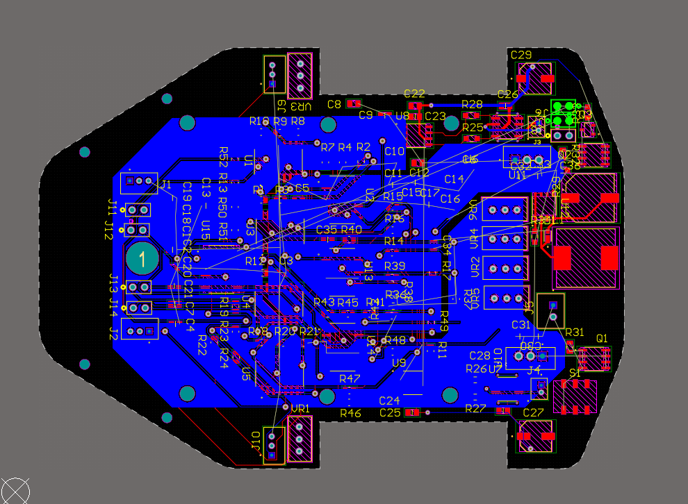

# ⚡ PCB Layout & Copper Pour Documentation

**Optimized Component Placement • Multi-Rail Power Planes • Low-Noise Grounding**

---

This directory contains the layout assets, preview images, and structural PCB design files for the controller board. The layout focuses on signal integrity, minimized trace lengths, noise isolation, and efficient power distribution across multi-layered copper pours.

---

## 1. Component Placement & Floorplanning

  

### 🔍 Placement Highlights
* 🔀 **Routing-Optimized Layout:** Components are strategically aligned to keep signal paths short, minimizing cross-coupling and routing complexity.
* 🛡️ **Signal Integrity:** Sensitive analog signal paths and high-frequency digital traces are isolated to prevent cross-talk and switching noise interference.
* 🧩 **Modular Functional Blocks:** Power management, Op-Amp signals, and sensor interfaces are grouped into dedicated functional zones for clear signal flow.

---

## 2. Top Layer Ground Pour (Top Copper)

  

### ⚡ Top Layer Features
* 🟩 **Continuous Ground Plane (GND):** Serves as a low-impedance return path for high-speed signals and sensor inputs.
* 🌡️ **Thermal Management:** Provides high surface area copper pour for efficient heat dissipation from power components and drivers.
* 📉 **EMI Reduction:** Continuous ground shielding dampens electromagnetic radiation across the upper board layer.

---

## 3. Bottom Layer Dual Power Pours (Bottom Copper)

  

### 🔋 Power Rail Distribution

| Rail | Coverage Zone | Purpose / Notes |
| :--- | :--- | :--- |
| **+5V Plane** | Primary Power Zone | High-current distribution for logic supply and sensors |
| **-5V Plane** | Isolated Power Zone | Dedicated negative supply rail for analog circuit biased components |

---

| Layer Count | Copper Weight | Target Impedance | Primary Grounding |
| :---: | :---: | :---: | :---: |
| 2-Layer Board | 1 oz Cu | Standard FR4 | Full Top Plane Pour |

