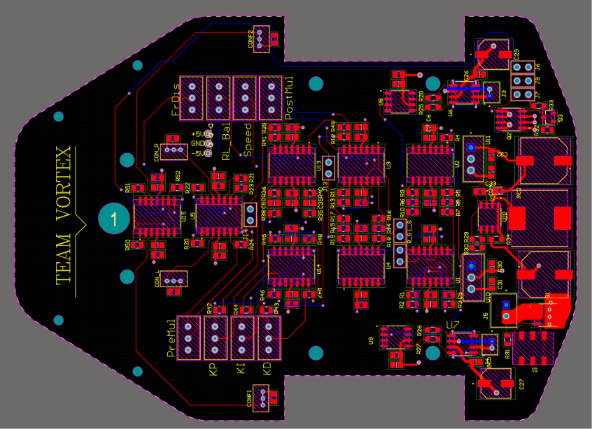
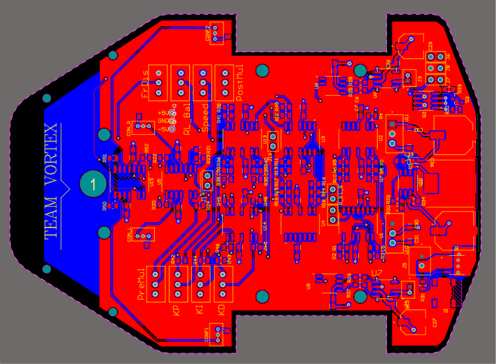
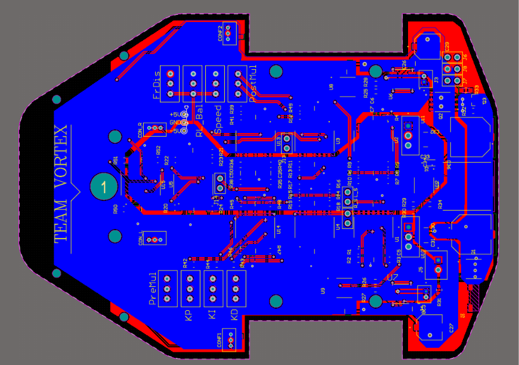
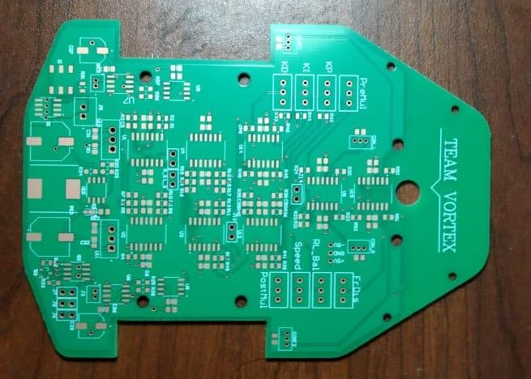
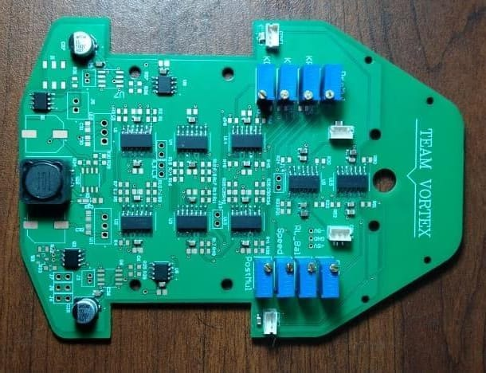

# ⚡ PCB Layout, Copper Pours & Hardware Assembly Documentation

**Precision Trace Routing • Low-Impedance Ground Plane • Dual-Rail Power Pours • Hardware Verification**

---

This repository contains the PCB layout assets, copper pour configurations, and physical hardware assembly documentation for the controller board. The board architecture emphasizes controlled trace widths, signal return stability, low-impedance dual-rail power delivery, and clean physical assembly.

---

## 1. Trace Routing & Current-Capacity Design

  

### 🛣️ Routing Strategy
- 🎯 **0.254 mm Signal Traces:** Standard **0.254 mm (10 mil)** trace widths are utilized across all low-current signal lines, delivering an optimal balance between routing density, manufacturing reliability, and clean signal propagation.
- ⚡ **High-Capacity Power Traces:** Dedicated power-carrying tracks are routed with significantly wider trace geometries tailored to their specific current demands.
- 🛡️ **Thermal & Current Safety Margin:** All power trace widths are sized well above their theoretical maximum current limits—incorporating a deliberate safety headroom to prevent resistive voltage drops, localized heating, and thermal stress under peak load.

---

## 2. Top Layer Ground Pour (Top Copper)

  

### 🟩 Ground Plane Architecture
- 🔄 **Continuous GND Return Path:** The top copper layer is flooded with a unified Ground (`GND`) plane, providing the shortest, lowest-impedance return path for high-speed and sensitive analog signals.
- 📉 **Signal Tail & Reference Stabilization:** By establishing an uninterrupted ground reference beneath and around signal traces, signal ringing, overshoot, and trailing transients are effectively dampened.
- ⚖️ **Balanced Charge Distribution:** The continuous copper pour promotes uniform electrostatic charge distribution across the entire PCB surface, minimizing ground bounce and electromagnetic interference (EMI).

---

## 3. Bottom Layer Dual-Rail Power Pours (Bottom Copper)

  

### 🔋 Split Power Plane Distribution
Rather than relying on narrow, routed power tracks—which introduce parasitic inductance and resistance—the bottom copper layer is partitioned into dedicated **+5V** and **-5V** copper pours to deliver smooth, low-noise power directly to the operational amplifiers (`Op-Amps`) and active analog stages.

| Power Rail | Copper Zone | Primary Function & Design Advantage |
| :--- | :--- | :--- |
| **+5V Pour** | Positive Supply Zone | Delivers smooth, low-impedance positive bias power to Op-Amps, logic, and sensor interfaces |
| **-5V Pour** | Negative Supply Zone | Provides an isolated, ripple-free negative supply plane for symmetric dual-rail Op-Amp operation |

---

## 4. Bare PCB Inspection (Pre-Assembly)

  

### 🔍 Fabricated Board Verification
- ✨ **Bare Board Quality:** View of the freshly fabricated, unpopulated PCB prior to component placement and soldering.
- 🧩 **Pad & Soldermask Integrity:** Confirms clean copper pad finishes, accurate silkscreen component designators, crisp soldermask clearances, and verified continuity across the top and bottom copper pours before assembly.

---

## 5. Assembled Hardware (Post-Soldering)

  

### 🛠️ Completed Board Assembly
- 🔧 **Component Population:** Fully populated controller board with all surface-mount and through-hole components soldered in place.
- ✅ **Joint & Thermal Inspection:** Verified clean solder fillets, proper component orientation, and reliable mechanical/electrical connections across power rails, Op-Amp stages, and I/O headers.

---

### 📋 PCB Design Specifications Summary

| Parameter | Specification | Design Purpose |
| :---: | :---: | :---: |
| **Board Stackup** | 2-Layer FR4 (1 oz Cu) | Cost-effective, robust double-sided layout |
| **Signal Trace Width** | 0.254 mm (10 mil) | Reliable high-density signal routing |
| **Power Trace Sizing** | Over-spec'd with safety margin | Prevents thermal rise & voltage drop under load |
| **Top Layer Copper** | Full `GND` Pour | Signal stabilization, EMI shielding & uniform charge flow |
| **Bottom Layer Copper** | Split `+5V` / `-5V` Pours | Low-impedance, smooth dual-rail power for Op-Amps |

