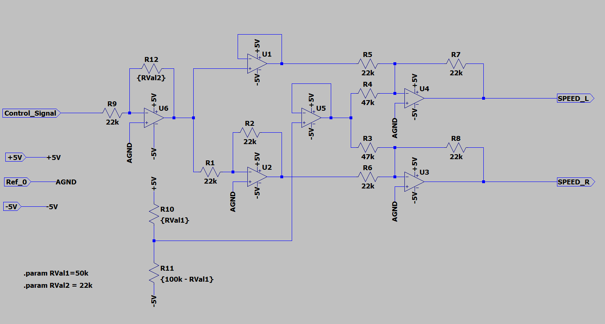
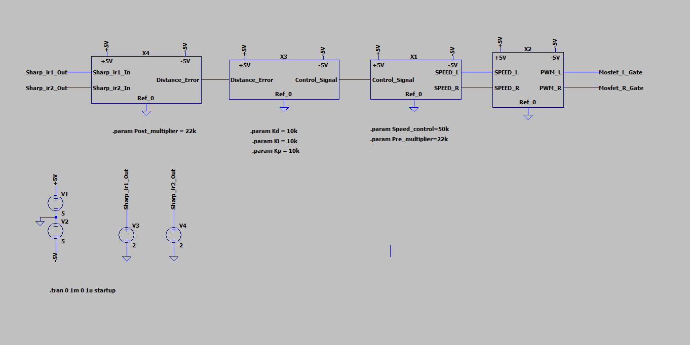
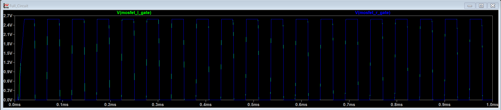
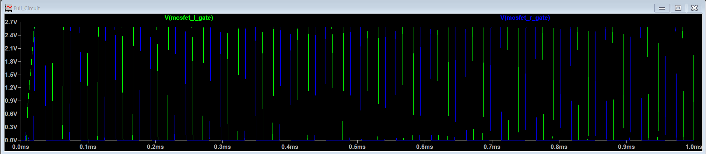

# 🔄 Closed-Loop Control & Circuit Simulation

**Multi-Stage Signal Processing • Real-Time Wall Following • Dual-PWM Motor Control**

---

This directory contains the schematic simulation models and performance waveforms for the Micromouse steering control system. The simulation models the full signal chain—from optical distance sensing and error calculation to PID loop compensation, differential motor mixing, and dual PWM signal generation.

---

## 🛠️ Functional Control Blocks

### 1. Sharp IR Sensor Interface

  

* 📡 **Signal Conditioning:** Processes raw analog outputs from the left and right distance sensors.
* ⚖️ **Error Extraction:** Calculates differential distance error ($\Delta E = d_{\text{left}} - d_{\text{right}}$) to quantify chassis offset relative to maze walls.

---

### 2. PID Controller

  

* ⏱️ **Temporal Error Processing:** Tracks rate of change and cumulative offset across proportional, integral, and derivative paths.
* 🎯 **Control Signal Output:** Computes continuous steering corrections to minimize wall proximity error and prevent overshoot.

---

### 3. Differential Drive Mixer

  

* 🔀 **Kinematic Translation:** Combines base forward velocity commands with the steering correction output.
* ⚙️ **Individual Speed Targets:** Translates steering vector into discrete target velocity references for the left and right motors.

---

### 4. Dual PWM Generator

  

* ⚡ **Pulse-Width Modulation:** Converts target motor speeds into precise duty cycles.
* 🚗 **Motor Drive Output:** Generates high-frequency gate drive signals for direct motor driver input.

---

## 🎛️ Complete System Schematic

  
  
<i>Integrated end-to-end circuit schematic containing sensor input conditioning, closed-loop PID control, differential mixing, and PWM stage.</i>

---

## 📊 Transient Simulation Results

### Centered Position ($\Delta E \approx 0$)

  

* 🟩 **Balanced Drive Output:** Both left and right PWM channels run at identical duty cycles, driving the robot in a straight line down the maze hallway.

---

### Offset/Sided Position ($\Delta E \neq 0$)

  

* 🟧 **Differential Steering Adjustment:** PWM duty cycles adjust dynamically—increasing speed on the near-wall motor and reducing speed on the far-wall motor to steer back toward the center line.

---

| Simulation Type | Input Source | Target Control Frequency | Output Drive Type |
| :---: | :---: | :---: | :---: |
| Transient / Closed-Loop | Dual Sharp IR Sensors | High-Speed Continuous | Dual PWM (Left / Right) |

