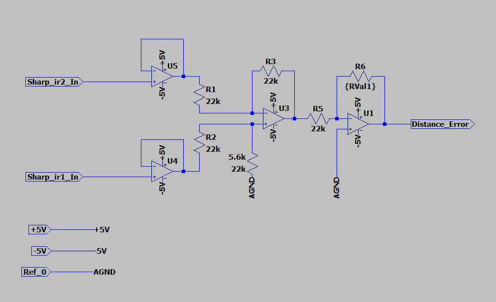
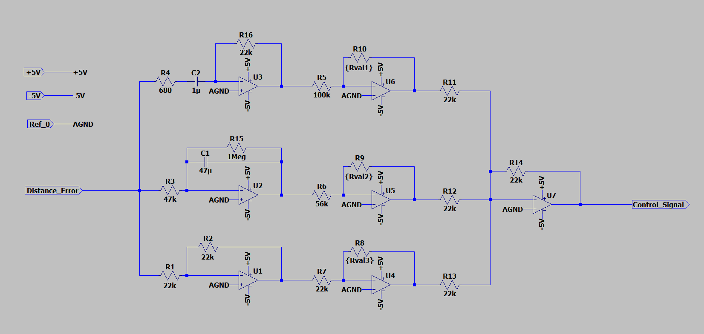
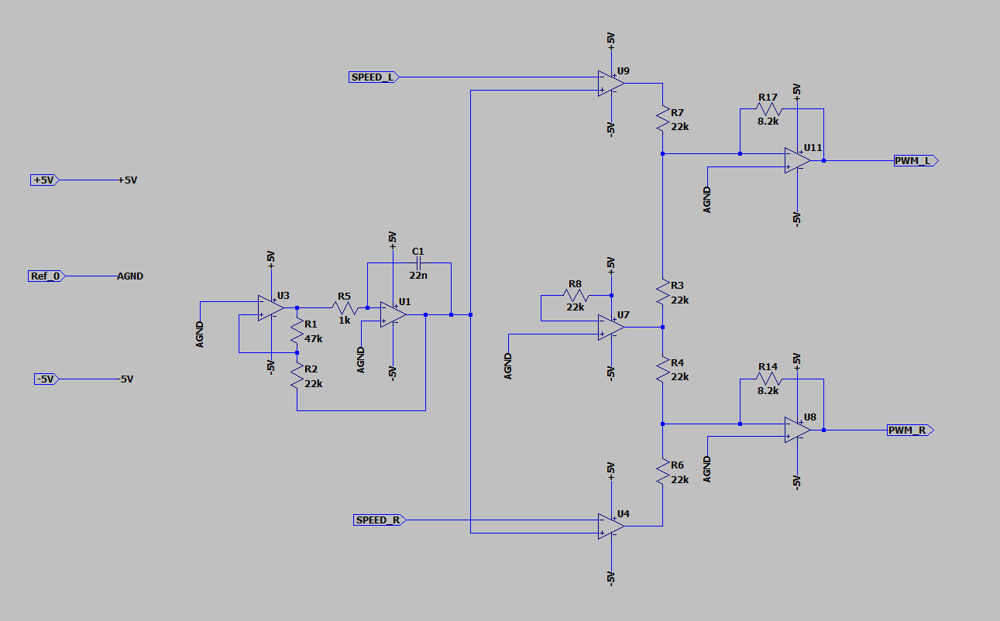

# 🔄 Closed-Loop Control & Circuit Simulation

**Multi-Stage Signal Processing • Real-Time Wall Following • Dual-PWM Motor Control**

---

This directory contains the schematic simulation models and performance waveforms for the Micromouse steering control system. The simulation models the full signal chain—from optical distance sensing and error scaling to PID loop compensation, differential motor mixing, and dual PWM signal generation.

---

## 🛠️ Functional Control Blocks

### 1. Sharp IR Sensor Interface

  

- 📡 **Signal Conditioning:** Processes raw analog outputs from the left and right distance sensors.
- ⚖️ **Scaled Error Extraction:** Computes differential wall offset scaled by a pre-multiplier gain:

$$\Delta E = (d_{\text{left}} - d_{\text{right}}) \times K_{\text{premul}}$$

---

### 2. PID Controller

  

- ⏱️ **Temporal Error Processing:** Evaluates proportional, integral, and derivative terms on $\Delta E(t)$ and scales the resulting control effort with a post-multiplier ($K_{\text{postmul}}$):

$$u(t) = K_{\text{postmul}} \left[ K_p \, \Delta E(t) + K_i \int_0^t \Delta E(\tau)\,d\tau + K_d \frac{d\,\Delta E(t)}{dt} \right]$$

- 🎯 **Control Signal Output:** Produces a scaled steering correction signal $u(t)$ to center the robot and damp oscillations.

---

### 3. Differential Drive Mixer

  

- 🔀 **Differential Speed Mixing:** Scales the base speed by $K_{\text{base}}$, applies an offset $u_{\text{offset}}$ to the steering signal $u(t)$, and adds/subtracts the resulting steering term across the left and right wheel channels:

$$V_{\text{left}} = (K_{\text{base}} \times V_{\text{base}}) - \bigl(u(t) + u_{\text{offset}}\bigr), \qquad V_{\text{right}} = (K_{\text{base}} \times V_{\text{base}}) + \bigl(u(t) + u_{\text{offset}}\bigr)$$

*(Sign convention follows your circuit/steering polarity—flipping $\pm$ reverses left/right steering bias.)*

- ⚙️ **Adjustable Speed & Offset:** Both $K_{\text{base}} \times V_{\text{base}}$ and $u_{\text{offset}}$ can be tuned to set nominal forward drive speed and compensate for steering/channel bias.

---

### 4. Dual PWM Generator

  

- ⚡ **Voltage-to-PWM Conversion:** Generates left and right PWM signals corresponding to the analog voltage levels output by the differential drive mixer ($V_{\text{left}}$ and $V_{\text{right}}$).
- 🚗 **Motor Drive Output:** Modulates duty cycle directly in proportion to each mixer command voltage to drive the left and right motor stages.

---

## 🎛️ Complete System Schematic

  
  
<i>Integrated end-to-end circuit schematic containing sensor input conditioning, closed-loop PID control, differential mixing, and PWM stage.</i>

---

## 📊 Transient Simulation Results

### Centered Position ($\Delta E \approx 0$)

  

- 🟩 **Balanced Drive Output:** When $\Delta E \approx 0$, $u(t) \approx 0$, and $u_{\text{offset}} = 0$, both channels track the scaled base speed voltage ($V_{\text{left}} \approx V_{\text{right}} \approx K_{\text{base}} \times V_{\text{base}}$), producing matched PWM duty cycles for straight-line motion.

---

### Offset/Sided Position ($\Delta E \neq 0$)

  

- 🟧 **Differential Steering Adjustment:** When $\Delta E \neq 0$, the mixer shifts one wheel voltage up and the other down by $\bigl(u(t) + u_{\text{offset}}\bigr)$, updating the corresponding PWM duty cycles to steer the Micromouse back toward the corridor center.

---

| Simulation Type | Input Source | Target Control Frequency | Output Drive Type |
| :---: | :---: | :---: | :---: |
| Transient / Closed-Loop | Dual Sharp IR Sensors | High-Speed Continuous | Dual PWM (Left / Right) |

